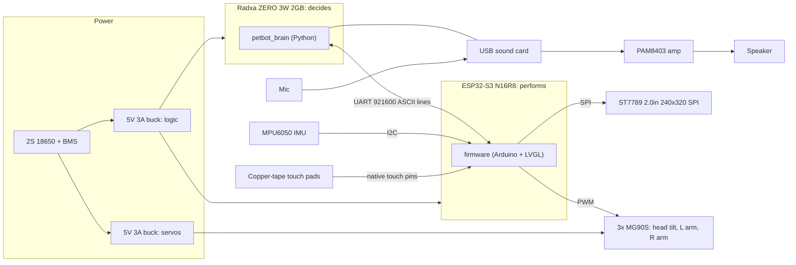

# PetBot Architecture

## Overview

PetBot is an Eilik-style desk pet: screen face, head tilt + 2 arms, touch reactions, and
later offline voice chat with a small local LLM.

Two brains (ADR 0001):
- **Linux board (Radxa ZERO 3W, 2GB)** decides: mood, voice, AI. Plain Python, no ROS 2.
- **ESP32-S3 DevKitC-1 N16R8** performs in real time: LVGL face, servos, touch, IMU.

They talk over UART at 921600 baud with newline-terminated ASCII lines
([protocol/PROTOCOL.md](../protocol/PROTOCOL.md)). If Linux crashes, the pet still blinks and reacts.

## Block diagram

Amp power source and rail assignment of display/IMU: TBD, decided during electronics integration.

## RAM budget (Radxa ZERO 3W, 2GB)

| Item | RAM | Source |
|------|-----|--------|
| Total | 2GB | ADR 0002 |
| Voice pipeline (wake word + STT + LLM + TTS) | ~1.0-1.2GB | ADR 0007 |
| OS + brain + everything else | remaining ~0.8-1.0GB | derived |
| Per-component split | TBD | measured in the 2GB Docker container (ADR 0010) |

The 1GB board variant was rejected because the voice pipeline alone does not fit.

## Development and deploy

- Sim-first (ADR 0010): LVGL desktop face sim, fake ESP32 over a socat virtual serial pair,
  voice pipeline in an arm64 Docker container capped at 2GB. No Gazebo.
- CI (ADR 0011): GitHub Actions builds firmware and runs brain tests. The robot pulls the
  latest release over Wi-Fi and re-flashes the ESP32 over UART. The laptop is used only for
  first-time flashing.

## Phase plan (ADR 0013)

| Phase | Scope | Status |
|-------|-------|--------|
| 1 | Expressive pet: touch + face + motion | Not started |
| 2 | Offline voice + local LLM (English first) | Not started |
| 3 | Camera/NPU face detection, then mobile EMO-style base | Not started |

## Decisions

See [adr/](adr/) for all Architecture Decision Records.
